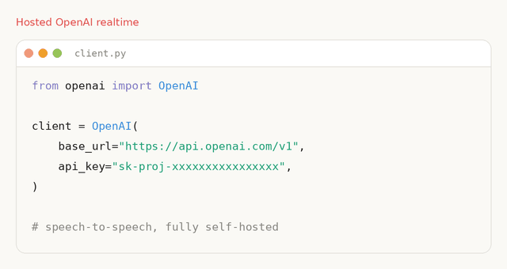
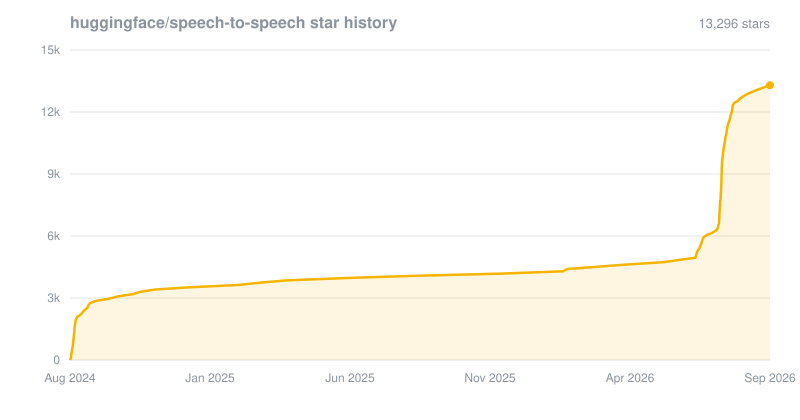

<div align="center">
  <div>&nbsp;</div>
  

# Speech To Speech: Build voice agents with open-source models

<p>
  <a href="https://trendshift.io/repositories/20645"></a>
</p>

[](https://pypi.org/project/speech-to-speech/)
[](https://pypi.org/project/speech-to-speech/)
[](./LICENSE)

</div>

A low-latency voice agent built from open models that **runs entirely on your computer**. One command starts a conversation: no API key, no cloud service.

The default pipeline is **Silero VAD → Parakeet TDT → Qwen3.5-4B → Qwen3-TTS**, and every stage is swappable. The server speaks the **OpenAI Realtime protocol** over WebSocket and WebRTC, so apps built for OpenAI's Realtime API can point at your own machine instead.

This pipeline runs in production as the conversation backend for thousands of [Reachy Mini](https://huggingface.co/blog/reachy-mini) robots.

<p align="center">
  <picture>
    <source media="(prefers-color-scheme: dark)" srcset="./docs/assets/endpoint-swap-dark.gif">
    <source media="(prefers-color-scheme: light)" srcset="./docs/assets/endpoint-swap-light.gif">
    
  </picture>
</p>

## Quickstart

Use CPython 3.11–3.14 (3.11 recommended):

```bash
python3 -m venv .venv
source .venv/bin/activate
pip install speech-to-speech
speech-to-speech local
```

Then talk: speak, pause, and the assistant answers through your speakers. Stop with `Ctrl+C`. The first run downloads the models, so give it a few minutes. On speakers, add `--echo-cancellation` so the assistant does not hear itself and you can still interrupt it by voice; headphones don't need it. See [echo cancellation](docs/echo-cancellation.md) for requirements and limits.

By default, `local` and `talk` show final user transcripts and streaming assistant
replies once, hiding backend transcript copies, routine logs, tool details, and protocol
events. User messages are yellow and assistant replies are green in a color-capable
terminal. Startup shows `Loading models…`, followed by `Ready — start speaking.` once
the audio devices are running and the session is configured. Routine model-loading
output is hidden; startup failures show their diagnostics. Runtime warnings and errors
remain visible.

For diagnostic output, add `--verbose`:

```bash
speech-to-speech local --verbose
```

Use `--verbose --log_level debug` for more detailed local logs. Raw event output
(`local --local_audio_print_json` or `talk --print-json`) also enables diagnostic output.

On Ubuntu, first install the audio libraries with `sudo apt-get install libportaudio2 libsndfile1`. The default Linux Qwen3-TTS wheel targets CUDA 12.8 and Ubuntu 24.04; see the [CUDA note](#cuda-note-for-qwen3-tts) for other systems. On Windows, activate the environment with `.venv\Scripts\Activate.ps1`.

The default installation has the following CI coverage:

| Platform | Supported CPython versions | Checks |
|---|---|---|
| Linux | 3.11, 3.12, 3.13, 3.14 | Full test suite and installed package smoke test |
| Apple Silicon macOS | 3.11, 3.12, 3.13, 3.14 | Installed package smoke test |

Optional model backends can have narrower Python requirements. Windows is not
covered by this compatibility matrix. Python 3.10 is no longer supported following
its end of life on October 1, 2026.

Kokoro is optional on every platform. On macOS, its Misaki dependency requires
Python <3.13, so use Python 3.11 or 3.12 with `speech-to-speech[kokoro]`.
The default Qwen3-TTS backend does not require Misaki. Python 3.15 is not yet
supported on any platform: ONNX Runtime lacks CPython 3.15 wheels, and the pinned macOS PyTorch
release also lacks them. Newer Python versions will be added after the default
dependencies and CI checks pass; the package's `requires-python` lower bound does
not promise compatibility with future Python releases.

The command picks local models for your platform:

| Platform | LLM | Plan for |
|---|---|---|
| Apple Silicon Mac | [Qwen3.5-4B 4-bit](https://huggingface.co/mlx-community/Qwen3.5-4B-4bit) via MLX LM | 16 GB of unified memory |
| Linux / Windows with NVIDIA | [Qwen3.5-4B](https://huggingface.co/Qwen/Qwen3.5-4B) via Transformers | 24 GB of VRAM |
| Other machines | Qwen3.5-4B via Transformers on CPU | Slow replies |

Speech recognition and synthesis run locally too. After the first run, everything works [offline](#offline-operation). To use another model, a llama.cpp server, or a hosted provider, see [LLM backends](#llm-backends).

### Connect your own app

`local` runs a server and a microphone client in one process. To run only the server:

```bash
speech-to-speech serve
```

It listens at `ws://127.0.0.1:8765/v1/realtime`. Connect with:

- the packaged audio client: `speech-to-speech talk --url ws://127.0.0.1:8765/v1/realtime`
- the [browser demo](./demo/README.md#quick-start-local)
- any client using the core OpenAI Realtime events; the OpenAI Agents SDK is tested over both transports (see [Realtime API](#realtime-api))
- [LiveKit Agents](./demo/livekit/README.md), as the agent's realtime model

## Index

* [How it works](#how-it-works)
* [Quickstart](#quickstart)
* [Installation](#installation)
* [YAML configuration API](./docs/configuration.md)
* [Offline operation](#offline-operation)
* [Supported components](#supported-components)
* [Commands](#commands)
* [Realtime API](#realtime-api)
* [LLM backends](#llm-backends)
* [Multi-language support](#multi-language-support)
* [OmniVoice](#omnivoice)
* [Pocket TTS](#pocket-tts)
* [Phonon TTS](#phonon-tts)
* [CLI reference](#cli-reference)
* [Contributing](#contributing)
* [Star history](#star-history)
* [Citations](#citations)

## How it works

The pipeline is a cascade of four components, each running in its own thread and connected by queues:

1. **Voice Activity Detection (VAD)**: [Silero VAD v5](https://github.com/snakers4/silero-vad) detects speech boundaries and turn-taking.
2. **Speech to Text (STT)**: transcribes the user's turn, with optional live partial transcripts.
3. **Language Model (LLM)**: generates the response, streaming text and tool calls.
4. **Text to Speech (TTS)**: synthesizes audio and streams it back to the client.

Every stage has multiple interchangeable backends, selected via CLI flags. The code is designed for easy modification, with a focus on models available through Transformers and the Hugging Face Hub.

Optional speech-to-viseme extraction adds timed mouth shapes for avatar and robot
clients after TTS. Enable it with `--enable_visemes`; see the
[viseme guide](src/speech_to_speech/STV/README.md) for client events and timing.

## Installation

`pip install speech-to-speech` (see the [Quickstart](#quickstart)) includes everything the default pipeline needs:

- Silero VAD and Parakeet TDT for listening
- Qwen3.5-4B for replies: MLX LM on macOS, Transformers elsewhere
- Qwen3-TTS for speech: `mlx-audio` on Apple Silicon, GGML elsewhere
- the local audio client and the Realtime server

Platform-specific dependencies are resolved automatically.

See the [configuration guide](./docs/configuration.md) for reusable blocks,
named pipelines, environment references, and explicit Python startup.
The [Mac example](./example_configs/mac.yaml) runs fully locally on Apple Silicon.
From a repository checkout, run its audio client and server together, or start
only the server:

```bash
speech-to-speech local -f example_configs/mac.yaml
speech-to-speech serve -f example_configs/mac.yaml --name mac
```

`local` runs one selected pipeline with the packaged loopback audio client.
`talk -f example_configs/mac.yaml` uses only the file's client settings.
Configured server startup currently supports one named definition per invocation; its
`num_pipelines` controls the number of isolated instances.
Existing Python interfaces, CLI commands, and flat JSON configuration remain available.

### CUDA Note for Qwen3-TTS

On Linux, the Qwen3-TTS GGML backend comes from `faster-qwen3-tts[ggml]`. Its default `qwentts-cpp-python` wheel on PyPI targets CUDA 12.8 and `manylinux_2_39` (for example, Ubuntu 24.04). If your CUDA runtime or glibc is older, install the matching wheel from the Hugging Face wheelhouse before installing `speech-to-speech`:

```bash
# CUDA 13.x
pip install "qwentts-cpp-python==0.3.1+cu130" \
  -f https://huggingface.co/datasets/andito/qwentts-cpp-python-wheels/tree/main/whl/cu130

# CUDA 12.4
pip install "qwentts-cpp-python==0.3.1+cu124" \
  -f https://huggingface.co/datasets/andito/qwentts-cpp-python-wheels/tree/main/whl/cu124

# CPU-only fallback
pip install "qwentts-cpp-python==0.3.1+cpu" \
  -f https://huggingface.co/datasets/andito/qwentts-cpp-python-wheels/tree/main/whl/cpu

pip install speech-to-speech
```

On **DGX Spark (Linux ARM64, CUDA 13)**, the default CUDA 12 wheel can fail with `libcudart.so.12` missing. From the repository root, sync dependencies, then install the CUDA 13 ARM64 wheel and launch with `--no-sync` as shown below. Plain `uv run` or `uv sync` can replace this wheel; reinstall it after syncing.

```bash
uv sync
uv pip install --python .venv/bin/python --no-deps \
  "https://huggingface.co/datasets/andito/qwentts-cpp-python-wheels/resolve/main/whl/cu130/qwentts_cpp_python-0.5.0%2Bcu130-py3-none-manylinux_2_39_aarch64.whl"
uv run --no-sync speech-to-speech serve
```

To use the previous CUDA-graphs implementation instead of GGML, pass `--qwen3_tts_backend torch`.

### Optional Components

Optional components are installed with pip extras:

```bash
pip install "speech-to-speech[kokoro]"          # Kokoro-82M TTS (macOS: Python 3.11–3.12)
pip install "speech-to-speech[kitten]"          # KittenTTS
pip install "speech-to-speech[pocket]"          # Pocket TTS
pip install "speech-to-speech[phonon]"          # Phonon TTS (checkpoint supplied separately)
pip install "speech-to-speech[chattts]"         # ChatTTS
pip install "speech-to-speech[omnivoice]"       # OmniVoice TTS (CUDA, Intel XPU, or Apple Silicon)
pip install "speech-to-speech[faster-whisper]"  # Faster Whisper STT
pip install "speech-to-speech[whisper-mlx]"     # Lightning Whisper MLX STT on macOS
pip install "speech-to-speech[paraformer]"      # Paraformer STT through FunASR
pip install "speech-to-speech[fireredvad]"      # FireRed streaming VAD
pip install "speech-to-speech[nemo]"            # Parakeet Unified, Nemotron, and Orukeet STT through NeMo
pip install "speech-to-speech[mlx-lm]"          # mlx-vlm support for vision models on macOS
```

Deprecated implementations, including MeloTTS, live in [`archive/`](./archive) and are no longer wired into the CLI.

**Note on DeepFilterNet:** DeepFilterNet, used for optional audio enhancement in VAD, requires `numpy<2` and conflicts with Pocket TTS, which requires `numpy>=2`. Install it manually only in environments where you are not using Pocket TTS.

### From Source

To work on the code, install [Git](https://git-scm.com/downloads) and [uv](https://docs.astral.sh/uv/getting-started/installation/), then run:

```bash
git clone https://github.com/huggingface/speech-to-speech.git
cd speech-to-speech
uv sync --python 3.11
source .venv/bin/activate
```

This installs the package in editable mode. With the environment activated, use the same `speech-to-speech` commands shown above.

## Supported Components

| Component | Backend | Platforms | Install |
|---|---|---|---|
| VAD | [Silero VAD v5](https://github.com/snakers4/silero-vad) | all | built-in |
| VAD | [FireRed Stream-VAD](https://huggingface.co/FireRedTeam/FireRedVAD) | CUDA / CPU | `fireredvad` |
| STT | [Parakeet TDT](https://huggingface.co/nvidia/parakeet-tdt-0.6b-v3) (default) | CUDA / CPU through nano-parakeet, Apple Silicon through MLX | built-in |
| STT | [Parakeet Unified](https://huggingface.co/nvidia/parakeet-unified-en-0.6b) | CUDA / CPU | `nemo` |
| STT | [Nemotron Speech Streaming](https://huggingface.co/nvidia/nemotron-speech-streaming-en-0.6b) | CUDA / CPU | `nemo` |
| STT | [Nemotron Streaming Farsi](https://huggingface.co/mehdi-hf/nemotron-asr-streaming-farsi), selected with `--stt nemotron-streaming --nemotron_streaming_model_name mehdi-hf/nemotron-asr-streaming-farsi` | CUDA / CPU | `nemo`, NeMo >=3.0, Python >=3.11 |
| STT | [Orukeet](https://huggingface.co/oruk/orukeet) | CUDA / CPU | `nemo` |
| STT | [Whisper](https://huggingface.co/docs/transformers/en/model_doc/whisper) through Transformers | CUDA / CPU | built-in |
| STT | [Faster Whisper](https://github.com/SYSTRAN/faster-whisper) | CUDA / CPU | `faster-whisper` |
| STT | [Lightning Whisper MLX](https://github.com/mustafaaljadery/lightning-whisper-mlx) | Apple Silicon | `whisper-mlx` |
| STT | [MLX Audio Whisper](https://github.com/huggingface/mlx-audio) | Apple Silicon | built-in on macOS |
| STT | [Paraformer](https://github.com/modelscope/FunASR) | CUDA / CPU | `paraformer` |
| STT | [Qwen3-ASR](https://huggingface.co/Qwen/Qwen3-ASR-0.6B-hf) through Transformers | CUDA / CPU, Apple Silicon | built-in |
| STT | OpenAI-compatible `/v1/audio/transcriptions` endpoint | local or remote HTTP server | built-in |
| STT | OpenAI Realtime transcription | hosted or compatible WebSocket server | built-in |
| STT | vLLM Realtime transcription (experimental) | local or remote vLLM server | built-in |
| LLM | [mlx-lm](https://github.com/ml-explore/mlx-lm) (default on macOS) | Apple Silicon | built-in on macOS |
| LLM | [Transformers](https://huggingface.co/models?pipeline_tag=text-generation&sort=trending) (default elsewhere) | supported accelerators / CPU | built-in |
| LLM | OpenAI-compatible API (`responses-api`, `chat-completions`) | optional hosted providers or self-hosted servers | built-in |
| TTS | [Qwen3-TTS](https://huggingface.co/Qwen/Qwen3-TTS-12Hz-1.7B-CustomVoice) (default) | GGML / CUDA on Linux, mlx-audio on macOS | built-in |
| TTS | [Kokoro-82M](https://huggingface.co/hexgrad/Kokoro-82M) | CUDA / CPU, Apple Silicon | `kokoro` (macOS: Python 3.11–3.12) |
| TTS | [KittenTTS](https://github.com/KittenML/KittenTTS) | CPU | `kitten` |
| TTS | [Pocket TTS](https://github.com/kyutai-labs/pocket-tts) | CPU / CUDA | `pocket` |
| TTS | [Phonon](https://github.com/gradium-ai/xn-ptts) | CPU (including Apple Silicon) | `phonon` |
| TTS | [ChatTTS](https://github.com/2noise/ChatTTS) | CUDA / CPU | `chattts` |
| TTS | [OmniVoice](https://huggingface.co/k2-fsa/OmniVoice) | CUDA / Intel XPU / Apple Silicon | `omnivoice` |
| TTS | [MMS TTS](https://huggingface.co/docs/transformers/model_doc/mms) | CUDA / CPU | built-in |
| TTS | OpenAI-compatible `/v1/audio/speech` endpoint | local or remote HTTP server | built-in |
| TTS | [Fish Audio Drama-3](https://huggingface.co/fishaudio/drama-3) (`--tts drama3`) | SGLang Omni on a local or remote GPU host | built-in client |
| TTS | [MiniMax](https://platform.minimax.io/docs/api-reference/speech-t2a-http) | hosted HTTP streaming | built-in |

Optional [streaming speaker diarization](./examples/streaming-diarization/README.md)
adds speaker labels to transcribed turns. Enable it with `--diarization` after
installing the supporting Transformers build; the linked guide has the current
model revision and setup while the merged [Transformers PR #49056](https://github.com/huggingface/transformers/pull/49056)
is awaiting a package release.

Select implementations with `--stt`, `--llm_backend`, and `--tts`. The CLI constructs configuration only for the selected backends; known options for inactive backends remain accepted for compatibility but are ignored with a warning. JSON configuration may likewise include extra inactive-backend keys, which are ignored. Run `speech-to-speech serve -h` for the defaults, or pass selectors before `-h` to see another combination's backend-specific flags (for example, `speech-to-speech serve --stt mlx-audio-whisper -h`).

For client-only TTS serving with vLLM-Omni or another compatible server, see
[OpenAI-compatible TTS](./docs/openai-compatible-tts.md).

For client-only speech recognition with vLLM, OpenAI's hosted Transcription API,
or another compatible server, see
[OpenAI-compatible STT](./docs/openai-compatible-stt.md).
For native incremental audio and partial transcripts, see
[stateful streaming STT](./docs/openai-compatible-stt.md#stateful-streaming-stt).

## Commands

| Command | Behavior | Use it when |
|---|---|---|
| `serve` | Runs the pipeline server over OpenAI Realtime WebSocket and WebRTC. | You are building an app or device against the API. |
| `talk --url <full-realtime-url>` | Runs the packaged microphone/speaker client. | You want to talk to an existing Realtime server. |
| `local` | Composes `serve` and `talk` in-process over loopback. | You want to run the server and talk to it from one command. |

`serve` binds to `127.0.0.1` by default; pass `--host 0.0.0.0` explicitly for network exposure. `local` always binds to loopback and connects the same packaged client at `ws://127.0.0.1:<port>/v1/realtime`.

The command only decides how the server and client run. Where replies are generated is set by `--llm_backend`, which is local by default for every command.

The packaged `local` client buffers 196 ms of received audio when using the
OpenAI-compatible TTS backend, which absorbs short delivery gaps from HTTP
speech inference. Other `local` backends and `talk` start playback immediately
by default. Use `--playback-buffer-ms <milliseconds>` to override either
default: a larger value resists stuttering but delays the start of each
response, while a smaller value starts sooner but is more sensitive to jitter.
This setting only controls the packaged Python client's speakers; browser and
other Realtime clients manage their own playback buffers.

The packaged client can opt in to local Python tools with `talk --tool-module <module>` or `local --tool-module <module>`. The module contract, programmatic API, and web-search examples (Serper, or keyless You.com) are documented in [Tool calling design](./src/speech_to_speech/api/openai_realtime/README.md#packaged-python-client-tools).

### Migrating from `--mode`

`--mode` is deprecated and will stop working soon. During this migration window, `speech-to-speech --mode realtime` runs `speech-to-speech serve`, and `speech-to-speech --mode local` runs `speech-to-speech local`; both print a warning. All other mode values have been removed and exit with guidance to use the new commands.

### Local Mac

On macOS, `local` and `serve` already run all three models through MLX. The optional `--mac-optimal-settings` preset also makes MPS the default device for supported components. It only sets defaults: explicit `--device`, component-device flags such as `--qwen3_tts_device`, and `--stt`, `--llm_backend`, `--model_name`, and `--tts` all win.

`--tts pocket`, `--tts phonon`, `--tts kokoro`, `--tts omnivoice`, and `--tts kitten` are also valid on macOS.

To compare the MLX quantization variants locally:

```bash
python scripts/benchmark_tts.py \
    --handlers qwen3 \
    --iterations 3 \
    --qwen3_mlx_quantizations bf16 4bit 6bit 8bit
```

### Docker

Install the [NVIDIA Container Toolkit](https://docs.nvidia.com/datacenter/cloud-native/container-toolkit/latest/install-guide.html), then:

```bash
docker compose up
```

The compose file starts a llama.cpp server with Gemma 4 and the Realtime server, exposing ports `8080` and `8765`.

## Realtime API

The server logs per-response STT, LLM, first TTS audio, and speech-to-audio
durations for supported backends, including vLLM-backed STT and TTS. See the
[response latency guide](./docs/response-latency.md) for the coverage matrix
and measurement boundaries.

Realtime mode supports the OpenAI Realtime protocol over WebSocket and WebRTC, with live transcription and low-latency turn-taking. WebSocket clients connect at `/v1/realtime`:

```python
from openai import OpenAI

client = OpenAI(
    base_url="http://localhost:8765/v1",
    websocket_base_url="ws://localhost:8765/v1",
    api_key="not-needed",
)

with client.realtime.connect(model="local") as conn:
    conn.send(
        {
            "type": "session.update",
            "session": {
                "type": "realtime",
                "instructions": "You are a helpful assistant.",
                "audio": {
                    "input": {
                        "turn_detection": {
                            "type": "server_vad",
                            "interrupt_response": True,
                        }
                    }
                },
            },
        }
    )

    for event in conn:
        print(event.type)
```

The server implements the core Realtime event set: `input_audio_buffer.append`, `session.update`, `conversation.item.create`, `conversation.item.truncate`, `response.create`, and `response.cancel` inbound; speech start/stop, streaming transcription, audio deltas, tool calls, and `response.done` outbound. CI connects pinned `@openai/agents` `RealtimeSession` instances through the SDK's stock WebSocket and WebRTC transports. This is a tested core subset, not a claim of full OpenAI Realtime API equivalence. The event matrix, architecture, and design details live in the [Realtime Engine README](./src/speech_to_speech/api/openai_realtime/README.md).

### LLM Proxy

With `--enable_llm_proxy`, the realtime server also exposes the remote LLM it is configured with as a plain OpenAI compatible endpoint, so a client can run side tasks (summaries, titles, background agents) with tools and streaming, fully concurrent with the voice conversation and never interrupted by new speech:

* `POST /v1/chat/completions` when running `--llm_backend chat-completions`
* `POST /v1/responses` when running `--llm_backend responses-api`

The server performs no authentication and no throttling of its own. Enable the proxy only on a trusted network, or deploy the server behind a gateway that owns access control. The s2s-endpoint compute replica is such a gateway: it opens these paths only to clients that created their session with an HF token, checks the API key against that token, and applies a rate limit per user. Point the stock OpenAI SDK at whichever host you talk to; this server ignores the API key (a gateway in front decides what it must be):

```python
from openai import OpenAI

llm = OpenAI(base_url="http://localhost:8765/v1", api_key="unused")
completion = llm.chat.completions.create(
    model="anything",  # ignored: the server forces its configured --model_name
    messages=[{"role": "user", "content": "Summarize the conversation so far: ..."}],
)
```

Requests are stateless (send the full message list each time) and are proxied to the configured upstream with the key held by the server, which never reaches clients. The `model` field is always overwritten with the server configured `--model_name`. The proxy is off by default, requires a remote backend (`chat-completions` or `responses-api`), and answers 501 with the reason otherwise.

## LLM Backends

By default the LLM runs inside the speech process. You can swap the model, run it in a separate server, or hand it to a hosted provider:

| Where the LLM runs | Backend |
|---|---|
| In process on Apple Silicon (default) | `mlx-lm` |
| In process elsewhere (default) | `transformers` |
| A separate server on your hardware (llama.cpp, vLLM, ...) | `responses-api` or `chat-completions` |
| A hosted provider | `responses-api` or `chat-completions` |

### Changing the local model

Pass `--model_name`, using an MLX conversion on Mac and a Transformers checkpoint elsewhere:

```bash
speech-to-speech local --model_name mlx-community/Qwen3.5-9B-4bit   # Apple Silicon
speech-to-speech local --model_name Qwen/Qwen3.5-9B                 # Linux / Windows
```

Transformers picks an available accelerator and falls back to CPU. `--llm_device` overrides the LLM's device; `--device` overrides every stage. Generation options such as `--llm_gen_max_new_tokens` are in the [LLM guide](./src/speech_to_speech/LLM/README.md).

### Combining with llama.cpp

Serve the LLM with llama.cpp and connect speech-to-speech through its local Responses API. This works on **Apple Silicon or Linux/NVIDIA**. Install llama.cpp with `brew install llama.cpp` on macOS or use a [CUDA build](https://github.com/ggml-org/llama.cpp/blob/master/docs/build.md#cuda) on NVIDIA.

With the default speech models, budget **24 GB of unified memory on Mac** or **16 GB of VRAM on NVIDIA**; about 8 GB of that goes to the speech pipeline.

Terminal 1 — start the LLM and leave it running:

```bash
llama-server \
    -hf ggml-org/gemma-4-E4B-it-GGUF:Q4_0 \
    --alias local-gemma \
    --host 127.0.0.1 --port 8080 \
    -ngl all -np 1 -c 8192 -fa on \
    --no-mmproj \
    --reasoning off
```

Terminal 2 — activate your Python environment and connect the speech pipeline to that LLM:

```bash
speech-to-speech local \
    --llm_backend responses-api \
    --model_name local-gemma \
    --responses_api_base_url http://127.0.0.1:8080/v1 \
    --responses_api_api_key ""
```

The [Q4_0 weights](https://huggingface.co/ggml-org/gemma-4-E4B-it-GGUF/blob/main/gemma-4-E4B-it-Q4_0.gguf) are about 4.6 GB. The example uses one 8k context and disables reasoning for faster replies; `--no-mmproj` skips the image/audio projector because STT supplies text. To try another GGUF model, change `-hf` and keep `--alias` and `--model_name` matched.

### Local speech with a hosted LLM

Select an API backend to move only the LLM to a provider. For OpenAI:

```bash
export OPENAI_API_KEY=...
speech-to-speech local --llm_backend responses-api
```

This uses `gpt-5.6-terra` with reasoning effort `none`. Speech recognition and synthesis stay local, so your audio never leaves your computer; transcribed text and conversation history go to the provider.

Two API backends share the same `--responses_api_*` connection flags:

- `--llm_backend responses-api` targets `/v1/responses`.
- `--llm_backend chat-completions` targets `/v1/chat/completions`.

### Responses API Backend

Works with any provider or server that implements the OpenAI Responses API. Point `--responses_api_base_url` at the endpoint and set `--model_name` accordingly:

| Provider / server | `--responses_api_base_url` | `--responses_api_api_key` |
|---|---|---|
| OpenAI | omit, uses OpenAI default | `$OPENAI_API_KEY` |
| HF Inference Providers | `https://router.huggingface.co/v1` | `$HF_TOKEN` |
| OpenRouter | `https://openrouter.ai/api/v1` | `$OPENROUTER_API_KEY` |
| vLLM | `http://localhost:8000/v1` | omit or any string |
| llama.cpp | `http://127.0.0.1:8080/v1` | empty string |

```bash
# OpenAI
speech-to-speech local \
    --llm_backend responses-api \
    --model_name "gpt-4o-mini" \
    --responses_api_api_key "$OPENAI_API_KEY" \
    --responses_api_stream \
    --enable_live_transcription
```

```bash
# HF Inference Providers: Qwen3.5-9B via Together
speech-to-speech local \
    --llm_backend responses-api \
    --model_name "Qwen/Qwen3.5-9B:together" \
    --responses_api_base_url "https://router.huggingface.co/v1" \
    --responses_api_api_key "$HF_TOKEN" \
    --responses_api_stream \
    --enable_live_transcription
```

```bash
# HF Inference Providers: GPT-oss-20B via Groq
speech-to-speech serve \
    --llm_backend responses-api \
    --model_name "openai/gpt-oss-20b:groq" \
    --responses_api_base_url "https://router.huggingface.co/v1" \
    --responses_api_api_key "$HF_TOKEN" \
    --responses_api_stream \
    --enable_live_transcription
```

### Chat Completions Backend

Identical configuration to `responses-api`, reusing the same `--responses_api_*` connection flags, but talks to `/v1/chat/completions` instead of `/v1/responses`. Prefer it when:

- the provider ignores `chat_template_kwargs.enable_thinking` on the Responses path and needs a `reasoning_effort` knob to suppress reasoning, or
- the server's Responses streaming tool-call path is unreliable, while its Chat Completions tool-call streaming is solid. This is useful for some vLLM builds; see [#312](https://github.com/huggingface/speech-to-speech/issues/312).

Add `--responses_api_reasoning_effort none` to disable reasoning on providers where the chat-template flag has no effect:

```bash
# vLLM serving a Qwen model with tool calling
speech-to-speech serve \
    --llm_backend chat-completions \
    --model_name "Qwen/Qwen3.5-4B" \
    --responses_api_base_url "http://localhost:8000/v1" \
    --responses_api_stream
```

```bash
# Gemma 4 31B via the HF router on Cerebras, with reasoning disabled for low voice latency
speech-to-speech serve \
    --llm_backend chat-completions \
    --model_name "google/gemma-4-31B-it:cerebras" \
    --responses_api_base_url "https://router.huggingface.co/v1" \
    --responses_api_api_key "$HF_TOKEN" \
    --responses_api_reasoning_effort none \
    --responses_api_stream
```

### Direct Audio Input (No STT)

Use `--stt none --llm_backend chat-completions` to send each completed VAD
audio segment directly to an audio-input model. Direct audio mode is not
supported with `--llm_backend responses-api`: a model may accept audio through
`/v1/chat/completions` without supporting `/v1/responses`, including OpenAI's
[`gpt-audio-1.5`](https://developers.openai.com/api/docs/models/gpt-audio-1.5).

You must explicitly set `--model_name` to a model that accepts audio: the
API backends' default `gpt-5.6-terra` accepts text and image input, but not audio. Check the
provider's model documentation and endpoint support before enabling this mode.
For OpenAI, see the
[GPT-5.6 Terra model card](https://developers.openai.com/api/docs/models/gpt-5.6-terra)
and [audio-input guide](https://developers.openai.com/api/docs/guides/audio#add-audio-to-your-existing-application).

```bash
speech-to-speech serve \
    --stt none \
    --llm_backend chat-completions \
    --model_name "YOUR_AUDIO_CAPABLE_MODEL" \
    --responses_api_base_url "https://provider.example/v1" \
    --responses_api_api_key "$PROVIDER_API_KEY"
```

OpenAI-compatible servers represent input audio differently. Use
`--responses_api_audio_content_type input_audio` (the default) for embedded
WAV base64, or `--responses_api_audio_content_type audio_url` for a base64
data URL.

For a fully local audio-input model on Apple Silicon, see the
[Gemma 4 12B example](./examples/gemma4-12b-macos/README.md).

## Offline Operation

The pipeline can run without internet access after the dependencies and model assets for the selected components
are installed locally. Before disconnecting, start the exact configuration once while online so it can cache the
STT, LLM, TTS, Silero VAD, NLTK, and Smart Turn resources it needs.

After that first run, set `HF_HUB_OFFLINE=1` to skip Hugging Face Hub requests:

```bash
HF_HUB_OFFLINE=1 speech-to-speech local
```

For the [llama.cpp configuration](#combining-with-llamacpp), keep the LLM server running and pass the same LLM flags:

```bash
HF_HUB_OFFLINE=1 speech-to-speech serve \
    --llm_backend responses-api \
    --model_name local-gemma \
    --responses_api_base_url "http://127.0.0.1:8080/v1" \
    --responses_api_api_key ""
```

Hosted LLMs still need a connection.

Smart Turn uses a separate ONNX checkpoint. A cached checkpoint works with `HF_HUB_OFFLINE=1`; for an explicit,
cache-independent setup, pass `--smart_turn_model_path /path/to/smart-turn-v3.2-cpu.onnx`. If the checkpoint is not
available, pass `--no_smart_turn` to disable Smart Turn.

## Multi-Language Support

Language coverage depends on the STT and TTS backends you pick, not on the pipeline itself:

| Component | Backend | Languages |
|---|---|---|
| STT | Parakeet TDT (default) | 25 European languages |
| STT | Whisper / Whisper MLX / Faster Whisper | Broad multilingual coverage, depending on the selected Whisper checkpoint |
| STT | Paraformer | Depends on the selected FunASR checkpoint; the default is Chinese-oriented |
| TTS | Qwen3-TTS (default) | Multilingual, with `--qwen3_tts_language auto` by default |
| TTS | Kokoro | Multiple language/voice mappings, depending on backend availability |
| TTS | KittenTTS | English |
| TTS | ChatTTS | English and Chinese |
| TTS | MMS TTS | Broad multilingual coverage through MMS checkpoints |
| TTS | OmniVoice | 600+ languages; voice cloning, design, and automatic voice selection |
| TTS | Supertonic | 32 languages |
| TTS | Pocket TTS | English, French, German, Portuguese, Italian, Spanish |
| TTS | OpenAI-compatible `/v1/audio/speech` endpoint | Depends on the connected TTS server/model |

Make sure the STT, LLM, and TTS you pair all cover your target language(s). By default, the language code sent to TTS comes from the **user's transcription**. Qwen3-TTS keeps its configured `auto` behavior by default. Add `--detect_llm_output_language` to detect the language of each assistant text chunk instead and send that code to TTS. This helps when the assistant replies in a different language from the user. The Lingua detector is loaded and warmed when the pipeline starts, so detection does not wait for the full reply. Short text (under 20 characters for most languages, or under four CJK characters) and ambiguous text use the last detected assistant language for that response. If there is none yet, TTS receives no language code and uses its own automatic or default behavior; this avoids delaying speech to collect more text. A TTS backend must support the detected language to use it. When a Realtime session selects a language with `session.audio.input.transcription.language`, STT keeps that language, but TTS receives the confidently detected assistant language instead. The first spoken text of each response decides; if it is too short or ambiguous, the whole response uses the session's selected language. If the active TTS backend cannot speak the detected language, that response uses the session's selected language.

For **Parakeet TDT**, the decoder chooses the transcription language automatically. `--parakeet_tdt_language` remains accepted for compatibility with existing commands, but setting it to a code such as `de` does not constrain decoding. The reported language is inferred with Lingua from the finished transcription when possible. Text shorter than 20 characters is not classified, and inconclusive or failed detection reports an unknown language rather than the configured or previous code. `--language` belongs to the Whisper backends; it does not control Parakeet. For Whisper and Whisper MLX, use `--language auto` to detect each turn, or a code such as `--language zh` to fix the language. Other STT backends have their own language flags; see the [STT component guide](./src/speech_to_speech/STT/README.md#language-support-by-handler).

To encourage replies in the user's detected language, add `--enable_lang_prompt`. It appends a per-turn instruction such as "Please reply to my message in French." The flag is off by default and works independently of `--detect_llm_output_language`. Qwen3-TTS uses `--qwen3_tts_language auto` by default: it infers language from text unless assistant language detection or a session selection supplies a supported code. Set `--qwen3_tts_language german`, for example, to force synthesis in German.

Automatic detection with Parakeet and a language instruction for the LLM:

```bash
speech-to-speech serve \
    --stt parakeet-tdt \
    --enable_lang_prompt \
    --detect_llm_output_language \
    --qwen3_tts_language auto
```

A single non-English language, Chinese in this example:

```bash
speech-to-speech serve \
    --stt whisper-mlx \
    --stt_model_name large-v3 \
    --language zh
```

Both commands also work with `--mac-optimal-settings`; explicit `--stt` flags override the defaults it sets.

## OmniVoice

OmniVoice provides voice cloning, voice design, and automatic voice selection across 600+ languages. Install its opt-in dependencies and provide a reference clip plus its transcript for voice cloning. This example uses CUDA on Linux or Windows; use `--omnivoice_device mps` on Apple Silicon, `--omnivoice_device xpu` with an Intel XPU-enabled PyTorch installation, or `--omnivoice_device npu` with an Ascend `torch_npu` installation:

```bash
pip install "speech-to-speech[omnivoice]"
speech-to-speech serve \
    --tts omnivoice \
    --omnivoice_device cuda \
    --omnivoice_ref_audio /path/to/reference.wav \
    --omnivoice_ref_text "Transcript of the reference clip."
```

The handler converts OmniVoice's completed 24 kHz float output into the pipeline's 16 kHz `int16` blocks. OmniVoice does not currently expose incremental audio through `generate()`, so the first block is available only after the full utterance has been synthesized. See the [TTS component guide](./src/speech_to_speech/TTS/README.md#6-omnivoice---tts-omnivoice) for saved prompts, voice design, devices, latency, and all backend flags.

The `omnivoice` extra is supported on Linux, Windows, and macOS. On non-macOS platforms, both OmniVoice and the built-in Qwen3 backend share Transformers 5 through `faster-qwen3-tts>=0.4.0`, so installing this extra keeps the default Qwen3 path available. Linux uses Qwen3's GGML extra by default; see the [CUDA note](#cuda-note-for-qwen3-tts) if its CUDA 12.8 / `manylinux_2_39` native wheel does not match your host.

> [!WARNING]
> OmniVoice's code is Apache-2.0, but its pretrained weights are CC-BY-NC and are not licensed for commercial use. Use voice cloning only with authorization and consent; do not use it for impersonation, fraud, scams, or other illegal or unethical activity.

## Pocket TTS

Pocket TTS from Kyutai Labs provides streaming TTS with voice cloning:

```bash
speech-to-speech serve \
    --tts pocket \
    --pocket_tts_voice jean \
    --pocket_tts_device cpu
```

Available voice presets: `alba`, `marius`, `javert`, `jean`, `fantine`, `cosette`, `eponine`, `azelma`. Custom voice files and Hugging Face paths also work.

### Pocket TTS Farsi v2

Select [mehdi-hf/pocket-tts-farsi-v2](https://huggingface.co/mehdi-hf/pocket-tts-farsi-v2)
with `--pocket_tts_model_name`. The handler normalizes Persian spelling, expands
numbers, and converts assistant text to phonemes with
`mehdi-hf/Homo-GE2PE-Persian-HF` before synthesis. Both models download on first use.

The released Pocket TTS package does not support this model's phoneme frontend
flags yet. Install the author's fork after the `pocket` extra. This command pins
an inspected commit for reproducibility:

```bash
pip install "speech-to-speech[pocket]"
pip install "pocket-tts @ git+https://github.com/mallahyari/pocket-tts@3807c204babb5fe54be8fe18a362a58315e870d6"
speech-to-speech serve \
    --tts pocket \
    --pocket_tts_model_name mehdi-hf/pocket-tts-farsi-v2 \
    --pocket_tts_voice /voices/persian-reference.wav \
    --pocket_tts_device cpu
```

Use a Persian reference recording as a local audio file or Hugging Face audio
URL. Preset voice states such as `jean` are incompatible with these weights.
The handler uses the first five seconds of the recording. It splits text at
sentence boundaries before phoneme conversion, adds a 0.25-second pause between
sentences, and limits synthesis chunks to 18 tokens. It keeps ezafe-linked words
together and rejects a linked phrase that exceeds the budget. Oversized G2P inputs
raise an error rather than lose text.
Configure the LLM to respond in Persian. This model choice stays fixed for the
session and does not switch languages based on STT detection.

Farsi synthesis bypasses the fork's orthographic sentence splitter so that `?`
remains a glottal-stop phoneme. It uses an EOS threshold of -2 and zero extra
frames after EOS. `--pocket_tts_temperature` overrides the model's default of
0.3; `--pocket_tts_eos_threshold` overrides -2. Each phoneme chunk is buffered
before playback. Silent, non-finite, or length-capped output is retried once,
then reported as an error. This adds one chunk's generation time before the
first audio block, but avoids playing a failed attempt. PCM conversion clips
peaks instead of wrapping, and downsampling preserves filter history across
playback blocks.

To check the handler with actual weights from a source checkout, run:

```bash
python scripts/check_pocket_tts_farsi.py --output-dir /tmp/pocket-tts-farsi-check
```

The check downloads the TTS and G2P models and the author's Persian reference
`samples/prompt_short_sentence.wav`. It uses seed 42 and temperature 0.3.
It synthesizes a greeting, a sentence with a Persian number, and a
two-sentence reply. It checks PCM block format, non-silent output, and response
completion, then saves WAVs and timing measurements. Listen to the WAVs to assess
pronunciation. Use `--voice /voices/reference.wav` to test your own recording.
The check saves native 24 kHz audio by default. Pass `--sample-rate 16000` to
compare with the pipeline's current 16 kHz playback output. The server and local
playback path still assume 16 kHz, so changing only `--pocket_tts_sample_rate`
to 24000 does not enable native-rate playback.

The model weights use [CC-BY-NC-4.0](https://huggingface.co/mehdi-hf/pocket-tts-farsi-v2)
and are for non-commercial use.

## Phonon TTS

Phonon from Gradium streams speech locally through the Rust-backed `ptts` Python runtime. Install the optional extra:

```bash
pip install "speech-to-speech[phonon]"
speech-to-speech local --mac-optimal-settings --tts phonon
```

The default checkpoint is [`gradium/phonon-31m-en`](https://huggingface.co/gradium/phonon-31m-en), a public English model under Apache-2.0. It downloads on first use without a Hugging Face login. `--phonon_tts_model_name` accepts another Hub repo or a local checkpoint directory, which must include its matching `config.json`, `tokenizer.json`, q8 `model.q8.gguf`, and voice embeddings. Besides the checkpoint's own voices, Phonon offers the [Phonon voice catalog](https://huggingface.co/gradium/phonon-voices) voices in the checkpoint's languages (37 for English). A catalog voice downloads on first use. Use `--phonon_tts_voice VOICE_NAME` to select one; omitting it uses the checkpoint's default. Keep private checkpoints outside the repository.

`local --tts phonon` lets you cycle through these voices using the terminal's left/right or up/down arrows. The selected voice is displayed immediately and applied after the current reply finishes, preserving the conversation. This requires an interactive macOS or Linux terminal. The standalone `talk` client can opt in with `--voices Zoey Harper Easton` and select its initial voice with `--voice Zoey`.

Phonon uses four native CPU threads by default, which performed better than the runtime's twelve-thread default on an Apple M3 Pro in local testing. Use `--phonon_tts_num_threads N` to tune it at startup; the setting is shared by all Phonon pipelines in the process.

Phonon ends each utterance with a long quiet tail, which adds a pause between sentence-streamed chunks. `--phonon_tts_max_trailing_silence_ms 120` shortens that tail toward a 120 ms target (minimum setting 40); omitting it, the default, preserves native audio. Audio below -60 dBFS RMS in 10 ms windows counts as quiet. Leading audio and internal pauses are kept. At most one second is removed per utterance, so a tail more than one second over the target stays longer than it, and the last output block's padding (up to 32 ms at the default block size) can add more. Speech is not delayed: only quiet audio beyond the target is held, until speech resumes or the utterance ends. Very quiet voices may need native audio.

Phonon runs on CPU even when STT or the LLM uses a GPU. Native audio is resampled to the pipeline's 16 kHz PCM16 output, and interruption closes the native stream. `--phonon_tts_language` fixes text normalization at startup; use `en` (the default), `fr`, `de`, `es`, `pt`, or `none`. Session language changes are restricted to that configured language. See the [TTS component guide](./src/speech_to_speech/TTS/README.md#10-phonon---tts-phonon) for installation and checkpoint options.

The Phonon 40M checkpoints, such as [`gradium/phonon-40m-en`](https://huggingface.co/gradium/phonon-40m-en), are gated and use CC BY-NC 4.0, so they are for non-commercial use. To use one, accept its terms on Hugging Face, set `HF_TOKEN` or run `hf auth login`, and pass `--phonon_tts_model_name gradium/phonon-40m-en`.

## CLI Reference

References for pipeline CLI arguments live in the [arguments classes](./src/speech_to_speech/arguments_classes) and in `speech-to-speech serve -h`. Client arguments are listed by `speech-to-speech talk -h`.

### Module-Level Parameters

See [ModuleArguments](./src/speech_to_speech/arguments_classes/module_arguments.py). It allows setting:

- a common `--device`, if every part should run on the same device
- macOS model/device defaults (`--mac-optimal-settings`)
- STT implementation (`--stt`)
- LLM backend (`--llm_backend`: `transformers`, `mlx-lm`, `responses-api`, or `chat-completions`)
- TTS implementation (`--tts`)
- logging level
- transcript logging (`--log_transcripts`)
- realtime pipeline pool size (`--num_pipelines`)
- PyTorch CPU thread count (`--torch_num_threads`)

Logs are content-free by default: transcript-bearing records report a character count rather
than the text, because logs are commonly retained by service managers, containers and hosted
log aggregators. Pass `--log_transcripts` to include full user and assistant transcripts when
debugging STT, LLM, TTS or Realtime behaviour; it logs a warning at startup because enabling
it writes conversation content wherever those logs are collected. The `talk` client takes the
same flag, as `--log-transcripts` or `--log_transcripts`.

`--torch_num_threads N` sets PyTorch's CPU intra-op thread count (`torch.set_num_threads`) for
the whole process. It is unset by default, which keeps the current behaviour: Silero VAD sets
PyTorch to a single thread when it loads, and that single thread also applies to every other
PyTorch model on the CPU. If your STT runs on the CPU, you can trade some Silero speed for
faster transcription:

```bash
speech-to-speech serve --stt parakeet-tdt --device cpu --torch_num_threads 8
```

The setting is shared: Silero and the CPU STT use the same thread count, and more threads can
slow Silero down, so measure the complete pipeline when choosing a value. It only affects
PyTorch; ONNX Runtime, MLX and other non-PyTorch backends keep their own thread settings. In a
YAML configuration, set it under `runtime` as `torch_num_threads`. See the
[`torch.set_num_threads` documentation](https://docs.pytorch.org/docs/stable/generated/torch.set_num_threads.html).

### VAD Parameters

See [VADHandlerArguments](./src/speech_to_speech/arguments_classes/vad_arguments.py). Notable options:

- `--thresh`: threshold value to trigger voice activity detection.
- `--min_speech_ms`: minimum duration of detected voice activity to be considered speech.
- `--min_speech_continuation_ms`: sustain-bar hysteresis threshold for speech that continues a reopenable soft-ended, uncommitted turn within the reopen window. The default and recommended pairing is `--min_speech_ms 384 --min_speech_continuation_ms 192`.
- `--min_silence_ms`: minimum length of silence intervals for segmenting speech. Default is 64 ms.
- `--short_segment_merge_ms`: optional merge window for stitching adjacent VAD segments that are each shorter than `--min_speech_ms`.
- `--speculative_reopen_ms`: delay response commitment for 800 ms after a soft-ended turn so immediately resumed speech can reopen it.
- `--unanswered_reopen_ms`: sanity cap on how long a soft-ended speculative turn that has not yet received any assistant output stays reopenable. With Smart Turn enabled, this is clamped to at least `--smart_turn_max_wait_ms` so a turn remains reopenable for its full grace.

### Smart Turn endpointing

[Smart Turn v3.2](https://huggingface.co/pipecat-ai/smart-turn-v3) can validate Silero's end-of-speech
decisions using the content and prosody of the current turn. Silero finalizes the segment
and STT/LLM work may begin speculatively. Complete turns start processing immediately and use
`--speculative_reopen_ms` (800 ms by default) before committing output. Incomplete turns wait
`--smart_turn_incomplete_delay_ms` (600 ms by default) before starting STT/LLM work, while their output remains
gated by `--smart_turn_max_wait_ms` (2 seconds by default). If speech resumes during either delay, the existing turn is
reopened as a newer revision, the accumulated audio is re-emitted, and work from the previous revision is
discarded before it reaches the user.

The turn tracker owns the conversation order and the `LISTENING`, `SOFT_ENDED`,
`ANSWERING`, and `CLOSED` states. VAD supplies speech boundaries and Smart Turn timing;
the tracker decides whether resumed speech reopens the current turn. The unanswered
reopen cap uses streamed-audio time, so a push-to-talk pause with no audio does not
advance it. Processing and output holds use wall-clock deadlines. Starting a newer
turn drops older work that has not committed; accepted output can finish.

Each response belongs to the input supplied to generation. The server records that
ownership on conversation items and accepted tool calls. A tool follow-up keeps its
originating input's turn. If a user message follows the tool call, the follow-up
answers that message's turn; if a newer turn closed without one, it moves to that
turn, so a late tool result is still spoken. Client input without a speech-turn
association stays untagged. A response cannot borrow the identity of speech still
being recorded.
These input records do not control turn state, reopening, or deadlines.

The server holds `input_audio_buffer.speech_stopped` and the final transcription while a turn can still
reopen. Resumed speech keeps the same open item and live transcription deltas
continue. Once the turn commits, the client receives one stop, an input-buffer commitment, the created
user item, and one final transcript, so its user-turn history matches the model's.
If transcription fails, the server sends the stop and failure after the reopen grace ends.

The base package includes the quantized CPU runtime and enables Smart Turn by default:

```bash
pip install speech-to-speech
speech-to-speech serve
```

The latest supported v3.2 CPU checkpoint downloads from the Hugging Face Hub on first use. Pass
`--smart_turn_model_path /path/to/model.onnx` to use a local model, or `--no_smart_turn` to disable Smart Turn.
Smart Turn is enabled by default for server sessions and the packaged local client.

Tune the completion cutoff with `--smart_turn_threshold` (default `0.5`). A higher threshold makes ambiguous
pauses more likely to use the longer speculative response grace.

### STT, LLM, and TTS Parameters

`model_name`, `torch_dtype`, and `device` are exposed for each STT, LLM, and TTS implementation. STT and TTS parameters use the handler prefix, for example `--stt_model_name` or `--qwen3_tts_device`. LLM model selection and chat settings are shared across backends via unprefixed flags, for example `--model_name` and `--chat_size`; backend-specific flags use the `responses_api_` prefix for the `responses-api` and `chat-completions` backends and the `llm_` prefix for local backends.

For example:

```bash
# Local transformers/mlx-lm backend
--model_name google/gemma-2b-it

# OpenAI-compatible backend
--llm_backend responses-api --model_name deepseek-chat --responses_api_base_url https://api.deepseek.com
```

### Generation Parameters

Other generation parameters can be set using the handler prefix plus `_gen_`, for example `--stt_gen_max_new_tokens 128` or `--llm_gen_temperature 0.7`. Parameters not yet exposed can be added to the relevant arguments class.

## Big Bench Audio system tests

Run a pinned 40-question audio sample or all 1,000 Big Bench Audio questions
through VAD, STT, the LLM, and TTS, with
per-category answer accuracy, audio latency, and protocol failures in JSON reports.
`src/speech_to_speech/evals/big_bench_audio/Dockerfile.eval` builds an image for
local GPU runs or Hugging Face Jobs;
`scripts/prepare_eval_space.py` optionally builds the image in a private HF Space.
Start with four questions, then compare reports across revisions. See
[Big Bench Audio system tests](docs/vibe-checks.md).

## Contributing

Issues and PRs are welcome. Good starting points are the [open issues](https://github.com/huggingface/speech-to-speech/issues). For larger changes, open an issue first to discuss the approach.

For local development:

```bash
uv sync --group dev
uv run pytest tests -q
uv run ruff check src tests
uv run ruff format --check src tests
uv run mypy src
```

To check turn ordering, Smart Turn timing, and Realtime routing on CPU:

```bash
CUDA_VISIBLE_DEVICES='' uv run pytest -q \
  tests/test_speculative_turns.py \
  tests/test_smart_turn.py tests/test_stt_stale_filter.py \
  tests/test_audio_input_notifier.py tests/test_lm_output_processor.py \
  tests/openai_realtime/test_response_input_identity.py \
  tests/openai_realtime/test_realtime_service.py \
  tests/openai_realtime/test_speculative_turn_protocol.py
```

The response-input tests include a delayed tool completing during synthetic speech,
using the packaged client coordinator, service, and VAD handler with mocked model
output and VAD probabilities. Run that reproduction alone with:

```bash
CUDA_VISIBLE_DEVICES='' uv run pytest tests/openai_realtime/test_response_input_identity.py -q -s
```

## Star History

[](https://github.com/huggingface/speech-to-speech/stargazers)

## Citations

If you use this pipeline, please also cite the component models you run. The defaults are:

### Silero VAD

```bibtex
@misc{SileroVAD,
  author = {Silero Team},
  title = {Silero VAD: pre-trained enterprise-grade Voice Activity Detector (VAD), Number Detector and Language Classifier},
  year = {2021},
  publisher = {GitHub},
  journal = {GitHub repository},
  howpublished = {\url{https://github.com/snakers4/silero-vad}},
  email = {hello@silero.ai}
}
```

### Parakeet TDT

```bibtex
@misc{parakeet-tdt,
  author = {NVIDIA},
  title = {Parakeet TDT 0.6B v3},
  publisher = {Hugging Face},
  howpublished = {\url{https://huggingface.co/nvidia/parakeet-tdt-0.6b-v3}}
}
```

### Qwen3-TTS

```bibtex
@misc{qwen3-tts,
  author = {Qwen Team},
  title = {Qwen3-TTS},
  publisher = {Hugging Face},
  howpublished = {\url{https://huggingface.co/Qwen/Qwen3-TTS-12Hz-1.7B-CustomVoice}}
}
```

Citations for optional backends such as Kokoro, KittenTTS, Pocket TTS, ChatTTS, Whisper variants, Paraformer, and MMS live in the respective [component READMEs](./src/speech_to_speech).
